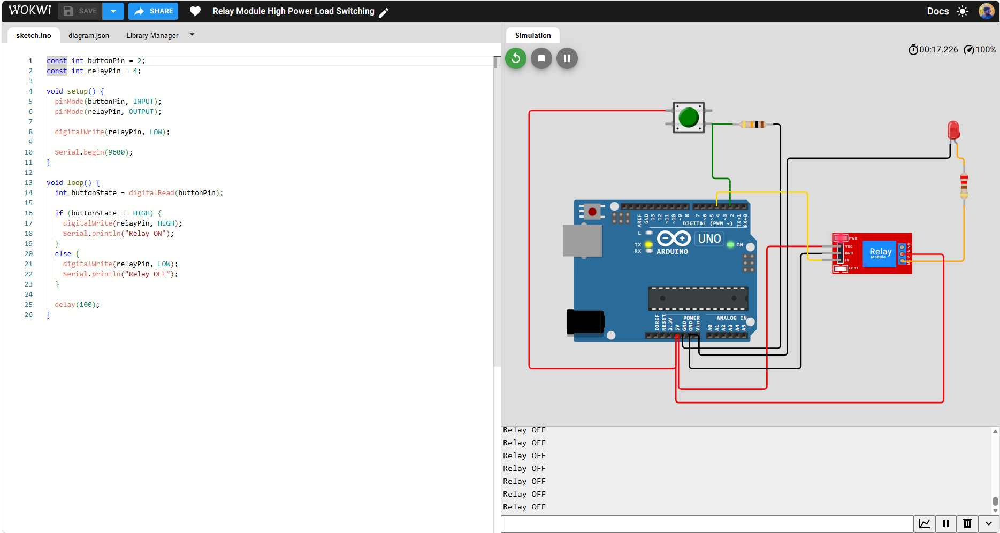
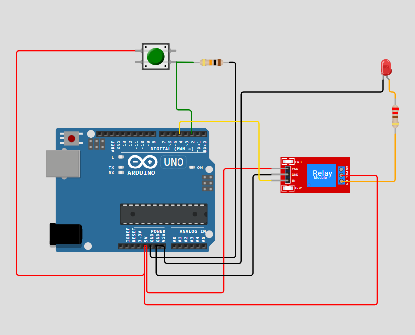
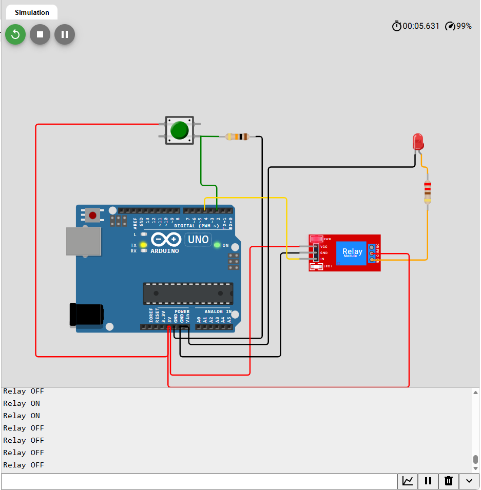

# Relay Module Load Switching — Arduino UNO / Wokwi



A beginner-friendly Arduino UNO simulation showing how a momentary pushbutton controls a **5V relay module**. A red LED stands in for a **low-voltage demonstration load**. The program prints `Relay ON` or `Relay OFF` to the Serial Monitor.

> **Safety:** This repository is a **low-voltage simulation and educational example only**. It does not document or validate the switching of mains electricity or actual high-power equipment. Do not use the demonstrated circuit as a mains wiring guide.

## What the project does

- Green pushbutton pressed: D2 reads HIGH; D4 is HIGH; relay switches ON; demonstration LED lights.
- Button released: D2 reads LOW; D4 is LOW; relay switches OFF; demonstration LED turns off.
- Messages appear in the Serial Monitor at **9600 baud**, every 100 ms.
- **Momentary behavior:** this project does *not* latch the relay ON after button release.

## Components

| Item | Quantity |
|---|---:|
| Arduino UNO | 1 |
| Wokwi relay module (simulated) | 1 |
| Momentary green pushbutton | 1 |
| 10 kΩ pull-down resistor | 1 |
| Red indicator LED (simulated load) | 1 |
| 220 Ω LED current-limiting resistor | 1 |

## Pin connections

| Source | Destination | Purpose |
|---|---|---|
| Arduino 5V | One pushbutton contact | Button supply |
| Other pushbutton contact | Arduino D2 | Active-HIGH input |
| Arduino D2 | 10 kΩ to GND | Pull-down to avoid floating input |
| Arduino D4 | Relay IN | Digital relay control |
| Arduino 5V | Relay VCC | Relay module supply |
| Arduino GND | Relay GND | Common ground |
| Arduino 5V | Relay COM | Safe simulated low-voltage supply |
| Relay NO | 220 Ω resistor → LED anode | Switchable indicator load |
| LED cathode | Arduino GND | Return path |

**Relay simulation setting:** Wokwi's relay has been set to `transistor: "pnp"` so a HIGH input energizes the simulated NO contact. This matches the sketch's active-HIGH output. The real hardware logic of relay boards varies: some are active LOW.

## File structure

```text
Relay-Module-Load-Switching-Arduino-Wokwi/
├── README.md
├── sketch.ino
├── diagram.json
├── libraries.txt
├── LICENSE
├── GITHUB_UPLOAD.md
├── src/
│   └── Relay_Module_Load_Switching.ino
└── docs/
    ├── WIRING.md
    ├── TESTING.md
    └── screenshots/
        ├── simulation-1.png
        ├── simulation-2.png
        └── simulation-3.png
```

## Run in Wokwi

1. Open [Wokwi's Arduino UNO starter](https://wokwi.com/projects/new/arduino-uno).
2. Replace the default `sketch.ino` with this repository's `sketch.ino`.
3. Replace its `diagram.json` with this repository's `diagram.json`.
4. Start the simulation, click the green button, and check the LED and Serial Monitor.

The supplied `diagram.json` is **reconstructed** from the screenshots, not exported from the original Wokwi project, and has **not been live-tested inside Wokwi**. The schematic was adapted to use Wokwi's active-HIGH relay setting and a demonstrably low-voltage load. Verify behavior after import.

## Uploaded screenshots

Original screenshots from the provided project are kept unmodified:




## Technical details

- Microcontroller: Arduino UNO (ATmega328P)
- Button: D2, active HIGH with external pull-down
- Relay control: D4, active HIGH
- Serial: 9600 bps
- Loop interval: 100 ms
- External Arduino libraries: none

## License

MIT — see [LICENSE](LICENSE).
